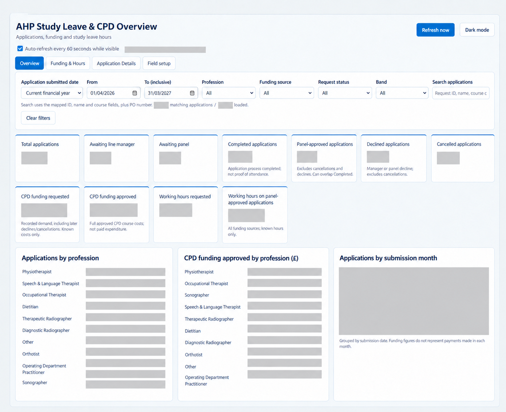

# AHP Study Leave & CPD Management Platform

## Project Overview

An automated Continuing Professional Development (CPD) and study leave management solution designed to streamline professional development requests, approvals, tracking, and reporting for healthcare teams.

This portfolio project demonstrates the design and implementation of a low-code business process automation architecture using Microsoft Power Platform technologies, integrated with modern UI frameworks and advanced data analytics.

---
For a high-level breakdown, see the [solution architecture](docs/architecture.md), [request process](docs/request-process.md), and [data model](docs/data-model.md).
Follow the [visual walkthrough](screenshots/README.md) for a redacted test application from submission to reporting. The [technical decisions](docs/technical-decisions.md) page explains the main design choices and current limitations. The [illustrative React dashboard example](PortfolioDashboardDemo.tsx) demonstrates filters and reporting calculations with fictional records. It is not the deployed Power Apps source. The [user journey guide](docs/user-guide.md) summarises the steps for applicants, line managers, and administrators.

## Business Problem

Traditional study leave management processes often rely on:
- Manual spreadsheets and disconnected paper trails.
- Email-based approvals lacking auditability.
- Limited visibility of request status for applicants.
- Time-consuming reporting processes for finance and management.

The objective was to create a centralised digital workflow that improves tracking, supports financial governance, and makes requested and approved CPD funding easier to report.

---

## Solution Architecture & Tech Stack

| Domain | Technologies Utilized | Core Implementation |
| :--- | :--- | :--- |
| **Database & Security** | Microsoft Dataverse | Relational data modeling, custom table architecture, and Role-Based Access Control (RBAC). |
| **Application Interface** | Microsoft Power Apps (model-driven app) and React code | Administrative app with a custom dashboard designed using React code in the Power Apps generative page and connected to Dataverse data. |
| **Process Automation** | Power Automate | Power Automate cloud flows supporting application capture, approvals, notifications and procurement tracking. |
| **Analytics** | Power BI & DAX | Data modelling and interactive reporting of funding, hours, outcomes and application volume. |
| **Intake** | Microsoft Forms | Standardized digital entry point for all initial applicant submissions. |

---

## Key Features

### Application Management
- **Digital Intake:** Standardized study leave request submission.
- **Structured Tracking:** End-to-end visibility of application lifecycles.
- **Approval Workflow:** Multi-tier authorization management.

### Workflow Automation
Automated backend processes include:
- Application capture and Dataverse record creation.
- Line manager review routing.
- CPD Panel decision escalation.
- Automated generation of procurement tracking documents.
- Post-course attendance confirmation triggers.

### Analytics Dashboard
Power BI reporting provides management visibility into:
- Total request volumes.
- Requests segmented by AHP profession.
- Financial tracking across multiple funding sources.
- Approval outcome ratios.
- CPD funding requested and approved, distinct from paid expenditure.

---

## Portfolio Evidence

The repository includes:

- [solution architecture](docs/architecture.md) and [request process](docs/request-process.md) diagrams;
- a [conceptual data model](docs/data-model.md);
- a [redacted visual walkthrough](screenshots/README.md) with dashboard, Power BI, and automation examples;
- [technical decisions](docs/technical-decisions.md) and a [user journey guide](docs/user-guide.md);
- an [illustrative React dashboard example](PortfolioDashboardDemo.tsx) using fictional data;
- lessons learned in this README.

---

## Quality & Governance

The solution was developed with consideration for:

- structured data management;
- automation reliability;
- error handling;
- maintainability;
- controlled migration using Power Platform solutions.

---

## Development Approach

The solution was developed using an iterative business improvement approach, starting from the identification of existing process limitations through to the implementation of a coordinated digital workflow with automated routing and notifications.

### Phase 1 — Process Analysis & Requirements Gathering

The existing study leave and CPD approval process was reviewed to identify:

- Manual administrative activities.
- Approval delays and communication gaps.
- Limited visibility of request progress.
- Challenges in tracking CPD expenditure and attendance.

Business requirements were translated into a structured digital workflow.

---

### Phase 2 — Data Architecture Design

A Dataverse data model was designed to provide a centralised source of truth.

Key design elements included:

- Custom AHP-SLR Applications table.
- Structured choice fields for funding source, request status and decisions.
- Tracking fields across the complete application lifecycle.
- Data relationships supporting reporting and workflow automation.

---

### Phase 3 — Workflow Automation Development

Power Automate cloud flows were developed to automate key business processes:

- Applicant submission processing.
- Line manager approval workflow.
- Panel decision processing.
- Procurement tracking.
- Supplier form management.
- Evidence document generation.
- Cancellation handling.
- Attendance confirmation and response capture.

---

### Phase 4 — Application Development

A Power Apps model-driven application was created to provide administrators and decision makers with:

- Centralised request management.
- Application status visibility.
- Structured review processes.
- Improved operational control.

The model-driven app includes a custom dashboard designed using React code in the Power Apps generative page and connected to Dataverse data.

---

### Phase 5 — Reporting & Analytics

Power BI dashboards were developed to provide management insight into:

- Total CPD requests.
- Requests by profession.
- Funding source analysis.
- Approval outcomes.
- CPD funding requested and approved.
- Training hours monitoring.

---

### Phase 6 — Testing & Refinement

The solution underwent iterative testing with stakeholders to improve:

- Workflow reliability.
- Data quality.
- User experience.
- Process governance.

Additional refinements included attendance automation, error handling improvements, and migration preparation into a dedicated Power Platform environment.

---
## Lessons Learned

- **Data mapping:** Matching Microsoft Forms responses to Dataverse fields required careful handling of choice values, text fields, and uploaded evidence.
- **Approval workflow:** Separating line manager and panel decisions made each stage easier to track and communicate to applicants.
- **Procurement:** Purchase orders and card payments needed different status updates and applicant messages.
- **Attendance:** A prefilled confirmation form and Request ID allow responses to be matched back to the correct application.
- **Reporting:** Building the operational dashboard and Power BI report revealed the importance of consistent status and funding definitions.
## Project Status

The internal solution is in use. This repository is a portfolio overview with selected redacted visuals and an illustrative dashboard component.

---

## Important Note

Screenshots have been redacted for portfolio use. Internal terms, the manager review question, personal details, record identifiers and operational figures are covered. Some images were recreated during redaction and should be read as illustrations of the workflow. The repository does not contain the production solution, live data or credentials.
