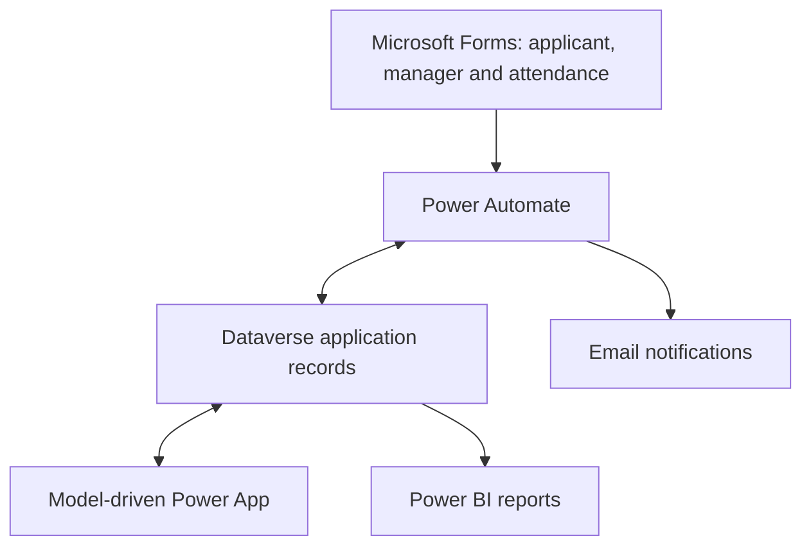

# Solution Architecture

## Overview

The study leave and CPD system brings request information into one Dataverse application record. Power Automate supports the review process, while the model-driven app gives administrators a place to manage requests. Power BI provides management reporting.

## Components

| Component | Role |
|---|---|
| Microsoft Forms | Collects applicant and line manager responses |
| Power Automate | Creates and updates records and sends workflow notifications |
| Microsoft Dataverse | Stores structured application and decision information |
| Model-driven Power App | Supports administration, review and status tracking |
| Power BI | Reports on requests, outcomes, funding and hours |

## Component connections

## Request journey

1. An applicant submits a study leave request.
2. Power Automate creates the application record in Dataverse.
3. The line manager reviews the request.
4. The panel records its decision.
5. Administrators track any required procurement steps.
6. Reporting uses the application data to show activity and outcomes.

## Portfolio scope

This document describes the solution at a high level. It contains no application records, credentials, connection details or solution export.
