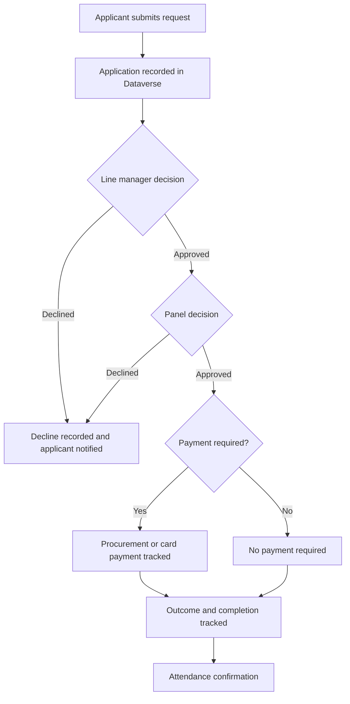

# Request Process

This is a high-level view of how an AHP study leave or CPD request moves through the system. Individual requests may need additional administrative review.

## Main stages

1. **Application:** The applicant submits the study leave or CPD request through Microsoft Forms. Power Automate creates the corresponding Dataverse record.
2. **Line manager review:** The line manager responds using a separate form linked to the request. Their decision is recorded against the application.
3. **Panel review:** The panel considers the request and records its decision.
4. **Funding and administration:** Approved requests that require payment move through the relevant procurement or card-payment steps. Approved requests with no payment requirement can follow a shorter completion path.
5. **Outcome and reporting:** Administrators track status and completion in the model-driven app. Power BI reports on request activity, outcomes, funding and hours.
6. **Attendance confirmation:** After the activity, a separate confirmation process can record whether the applicant attended.

This overview omits personal data, internal links, credentials and detailed operational settings.
